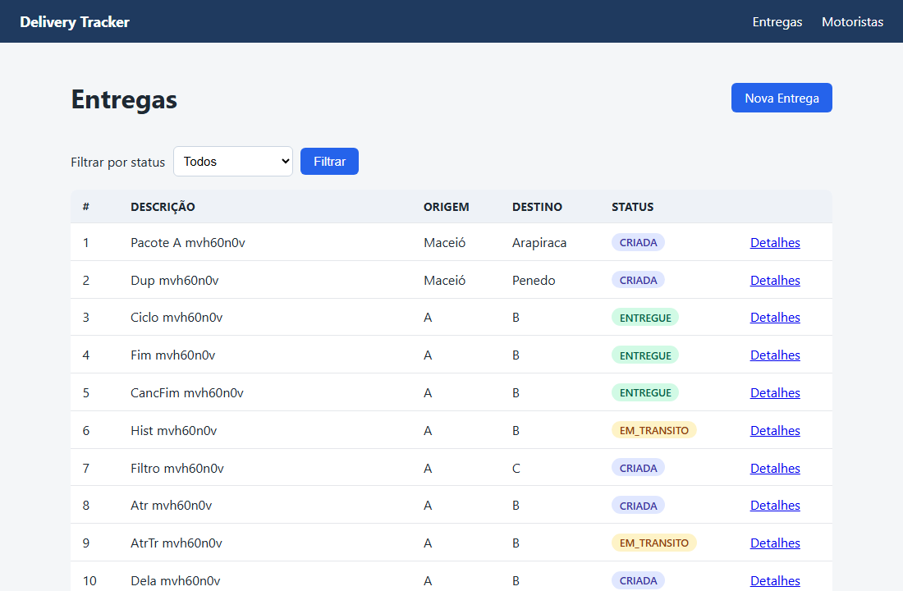

# Delivery Tracker

Projeto da disciplina **Programação Web II (IFAL/Maceió)**. Sistema para rastrear o ciclo de vida de
entregas e motoristas, construído em camadas (controllers, services, repositories) com Node, Express,
Prisma + SQLite e, agora, **interface web renderizada no servidor com EJS**.



## Como rodar

```bash
npm install
cp .env.example .env          # no Windows: copy .env.example .env  (DATABASE_URL="file:./dev.db")
npx prisma migrate dev        # cria o banco e aplica as migrations
npm run dev                   # ou npm start; abra http://localhost:3000 no navegador
```

- `GET /api/health` responde `{ "status": "ok" }` (só para checar se o servidor subiu).
- A porta pode ser trocada com a variável `PORT`.
- Em produção/CI use `npx prisma migrate deploy` no lugar do `migrate dev`.
- Para inspecionar o banco: `npx prisma studio`.

## Rotas da interface web

| Método | Caminho | O que faz |
|---|---|---|
| GET | `/` | Redireciona para `/entregas` |
| GET | `/entregas` | Lista as entregas (filtro opcional `?status=`) |
| GET | `/entregas/nova` | Formulário de nova entrega |
| POST | `/entregas` | Cria a entrega e redireciona (PRG). Inválido: reexibe o formulário (400) |
| GET | `/entregas/:id` | Detalhe com status e histórico (404 em página HTML se não existir) |
| PATCH | `/entregas/:id/avancar` | Avança o status e redireciona |
| PATCH | `/entregas/:id/cancelar` | Cancela e redireciona |
| PATCH | `/entregas/:id/atribuir` | Atribui o `motoristaId` escolhido no `<select>` e redireciona |
| GET | `/motoristas` | Lista os motoristas |
| GET | `/motoristas/novo` | Formulário de novo motorista |
| POST | `/motoristas` | Cadastra e redireciona. CPF duplicado: reexibe o formulário com o erro |

Os formulários HTML só enviam GET e POST. As ações de estado usam **method-override**: o botão faz
`POST /entregas/:id/avancar?_method=PATCH` e o servidor trata como `PATCH`.

### Como a interface funciona

- **EJS com layout:** `src/views/layouts/base.ejs` envolve todas as telas, com os partials `navbar`,
  `flash` e `erros-form`.
- **Post-Redirect-Get (PRG):** toda escrita bem-sucedida responde com redirect, nunca com HTML direto.
- **Mensagens flash** (`express-session` + `connect-flash`): aparecem na página seguinte à ação.
- **Validação** (`express-validator`): formulário inválido volta com as mensagens e com os dados
  digitados, com status 4xx.
- **Erros:** entrega inexistente ou rota desconhecida renderizam uma página 404 em HTML.
- **Regras de negócio** (origem diferente de destino, duplicidade, transições de status, atribuição só
  em entrega `CRIADA` com motorista `ATIVO`) continuam nos services e aparecem como mensagem na tela.

## Arquitetura

```
src/
├── controllers/   # traduz HTTP em chamada de service e renderiza view / redireciona
├── services/      # TODA a regra de negócio
├── repositories/  # só acesso a dados (contratos em contratos.js; implementação com Prisma)
├── config/        # singleton do Prisma Client
├── middlewares/   # validação (express-validator), flash e tratamento de erros em HTML
├── routes/        # composition root: único lugar com `new` de repository/service/controller
├── views/         # layout, partials e telas EJS
├── public/        # CSS
└── utils/         # classes de erro de negócio
```

Os services dependem só dos contratos `IEntregasRepository` e `IMotoristasRepository`
(`src/repositories/contratos.js`), então o repository pode ser trocado (ou substituído por um Mock)
sem mexer nos services.

```
                  Prisma Client (src/config/database.js)
                     /                       \
   EntregasPrismaRepository        MotoristasPrismaRepository
             |        \         /        |
             |     EntregasService        |
             |           |                |
             |   EntregasController       |
             |    (recebe também          |
             |   MotoristasService)       |
             |                            |
             +----- MotoristasService ----+
                           |
                  MotoristasController
                           |
              criarRotas() -> páginas EJS
```

## Persistência com Prisma + SQLite

Os dados ficam num banco SQLite (`dev.db`), então sobrevivem a reinícios do servidor. O schema está em
`prisma/schema.prisma` (modelos `Entrega`, `Motorista` e `Evento`, que guarda o histórico) e as
migrations versionadas em `prisma/migrations/`. O `dev.db` e o `.env` ficam fora do git.

## Histórico do projeto

- **Atividade 05:** entregas em camadas (controller, service, repository) em memória.
- **Atividade 06:** motoristas, contratos de repository em JSDoc e injeção de dependência.
- **Atividade 07:** persistência com Prisma + SQLite.
- **Atividade 08:** interface web com SSR (EJS), PRG, flash e validação de formulários.
